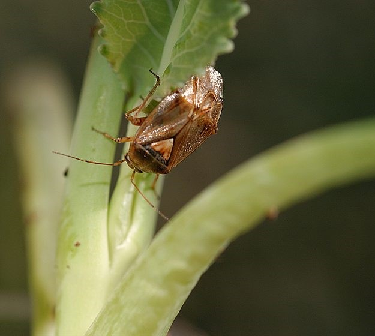

# LygusRugulipennisModel

<p></p>
<h3>Model description</h3>
<p>The pest prediction&nbsp;model LYGUSRUGUL (&ldquo;European tarnished plant bug &ndash; flight activity in vegetables&rdquo;) is based on several years' studies of the relation between maximum temperatures and bug activity in carrot fields (Tor J. Johansen, unpublished). It was implemented in VIPS in 2008. The forecast indicates the risk of flight activity and damage in the fields. The need for control measures is further based on the plant development stage, and expected bug population size at each locality. Local temperature observations should be used when the weather station is distant.</p>
<p>The model is activated on April 1st, and input is daily maximum temperature (TXD) for risk calculation. Both historic data and temperature prognoses (for up to two days) are used.</p>
<h3>Interpretation of warning status</h3>
<p>Green boxes: No risk for flight activity into the field. This color is presented in the period before flight activity is expected (max temperature &lt; 15 &deg;C), and if temperature drops below 10 &deg;C after a warning of flight risk (yellow or red boxes).</p>
<p>Yellow boxes: Possible risk for flight activity and damage to plants. The bugs are ready for flight into the field, or are inactive in the field due to low temperatures. This color is presented for the first time after three days with daily maximum temperature of at least 15 &deg;C (not necessarily continuously). After this, on days with maximum temperatures between 10 and 15 &deg;C.</p>
<p>Red boxes: Great risk for flight activity and damage to plants in the field. This color is presented for the first time after four days with daily maximum temperature of at least 15 &deg;C (not necessarily continuously). This forecast continuous as long as temperatures remain on this level, and changes to yellow on the first day with temperatures below 15 &deg;C. After this, it changes to red color every day with maximum temperature of at least 15 &deg;C. Red boxes now indicate that temperatures for flight into the fields are sufficient, and that there is a great risk for flight activity and damage to the plants. Actual damage requires&nbsp;an established plant stand (after seed-leaf stage).</p>
<p>Grey boxes: Low risk of damage to the plants at the actual station, and closed forecasting service.</p>
<h3>Validation of the model</h3>
<p>After implementation of the model in VIPS (2008) it has been validated over several years (2008-2013) by comparing actual bug activity (pheromone and/or collision traps) with forecasting based on in-field temperature registrations. The bug activity corresponded well with the risk forecast. Longer distance to the weather station will lead to less accurate warning.</p>

### Development

Clone Gitlab repository

```
$ git clone https://gitlab.nibio.no/VIPS/models/java/Model_LYGUSRUGUL.git
$ cd Model_LYGUSRUGUL
```